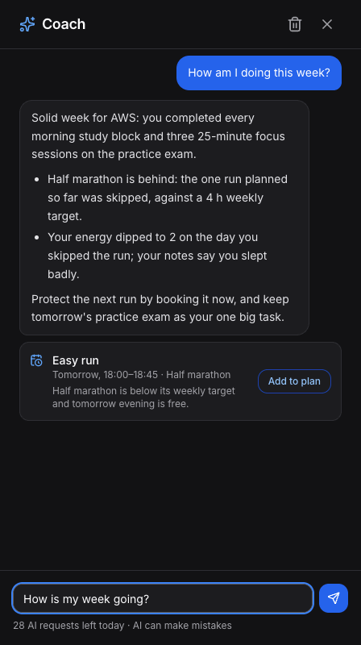
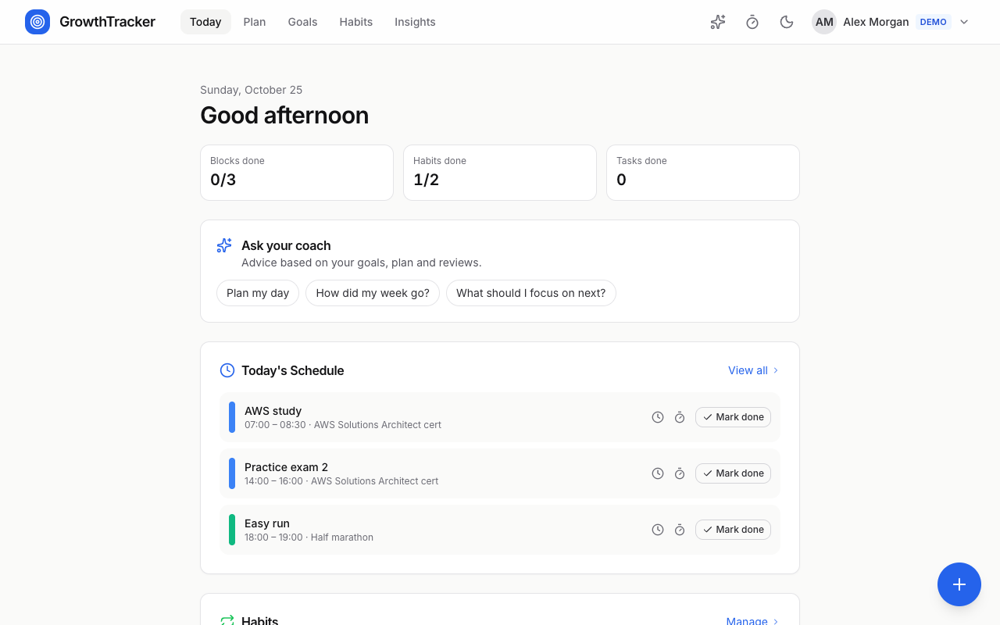
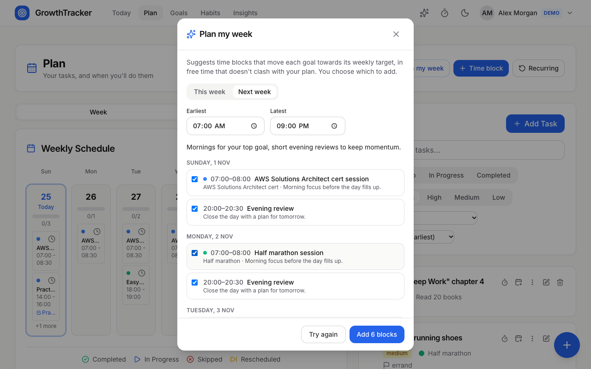
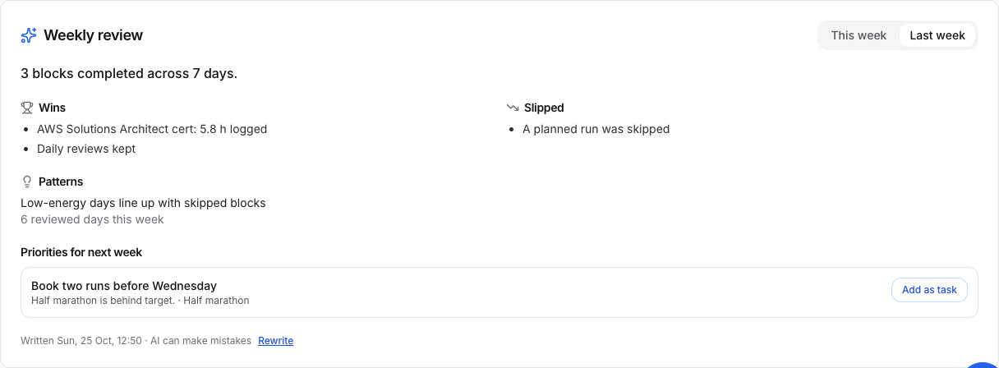
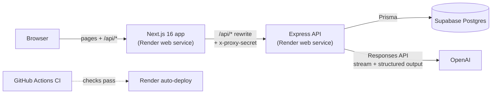

# GrowthTracker

[](https://github.com/Nadeeja99/GrowthTracker/actions/workflows/ci.yml)

**Plan the week, do the day, review it, and see what actually moves your goals,** with an AI coach that reads your own data.

A full-stack planner with goals, time blocks, tasks, habits, a focus timer and analytics. On top sit OpenAI-powered features: a streaming coach, weekly reviews, week planning and milestone suggestions, all validated server-side before they touch your data.

**Live demo:** _add the Render URL after the first deploy_. Press **Try the demo** for a seeded account; no sign-up needed. · **[Case study](docs/CASE_STUDY.md)**

<p align="center">
  
</p>

| Today | Plan my week (AI) | Weekly review (AI) |
|---|---|---|
|  |  |  |

### Highlights
- **AI that's safe to let near real data:**
  - a streamed chat over Server-Sent Events, plus strict JSON-schema structured output
  - every answer re-validated with zod, and rules the model can't be trusted with enforced in code (no overlapping blocks, nothing in the past, only your own goals)
  - opt-in, per-user and global daily caps, and a usage log
- **Production-shaped:**
  - same-origin proxy, so the auth cookie stays first-party; httpOnly rotating refresh tokens and an in-memory access token
  - rate limiting, request IDs and structured logs
  - Prisma migrations, and zod-validated configuration that refuses to boot when it's wrong
- **Tested end to end:**
  - 86 API integration tests against real Postgres, including the real OpenAI SDK against a local fake of its streaming protocol
  - 34 unit tests
  - 26 Playwright journeys with axe-core accessibility checks
  - CI runs all of it on every push, and Render deploys only after CI passes
- **Accessible and fast:**
  - Lighthouse 100 for accessibility and best practices on every page, 92–96 for performance
  - zero axe violations in light and dark mode; keyboard-complete dialogs

### Architecture



The browser only talks to the Next.js app, which forwards `/api/*` to the API with a shared secret. The API rejects anything that didn't come through the app. [Deployment](#deployment-render--supabase-free-tier) explains why: on `onrender.com` a cross-service cookie would be third-party.

---

## Features

Five areas, one loop: **plan** the week, **do** the day, **review** it, and **learn** from the data.

### Today
- Today's time blocks, daily habits and due tasks in one place, each with a one-tap **Focus** button
- Daily review: performance, energy and mood (1–5) plus notes, saved to your account
- 7-day completion strip and weekly hours per goal (planned target vs. actual)

### Plan
- **Tasks** with saved subtasks, tags, priority (low / medium / high), due dates and goal links
- **Timeline**: week calendar and hour-by-hour day view of time blocks; block statuses pending, in-progress, completed, skipped, rescheduled
- **Schedule a task** straight onto the timeline (prefilled block linked to the task)
- **Recurring blocks**: date range + weekdays, created in a single bulk request

### Goals
- Description, target date, colour, weekly/daily hour targets and priority
- **Milestones** break a goal down and drive its progress
- Weekly hours and streaks are derived from completed blocks and focus sessions (focus inside a planned block replaces the block's planned time, so nothing is counted twice)

### Habits
- Daily, weekly or monthly habits with a target count, one-tap completion, streaks and a 30-day heatmap

### Insights
- Server-computed summary for the selected range: focused time, task completion, habit consistency, average energy
- Charts for time allocation, trends and completion rates

### AI Coach (OpenAI)
- Chat with a coach that reads your goals, open tasks, this week's blocks, habits and recent daily reviews, and answers with specifics ("AWS is at 5.8 h of its 6 h target")
- Replies **stream** in as they're written; you can stop one mid-way
- The coach can **propose up to three actions** (a task, a time block at a free slot, or a habit), each added to your plan with one click
- Opt-in: nothing is sent to OpenAI until you turn the coach on; the data shared is listed up front, and it can be switched off or cleared in Settings
- Starter prompts on the Today page; works across tabs (a reply keeps streaming if you close the panel)

### AI growth features
- **Weekly review** (Insights): wins, what slipped, **patterns** linking your daily energy, mood and notes to what got done, and priorities for next week, each addable as a task. Generated on request and saved, so revisiting it costs nothing.
- **Plan my week** (Plan): proposes time blocks that move each goal towards its weekly target, inside the hours you choose. You tick the ones you want and add them in one go.
- **Suggest milestones** (Goals): breaks a goal into checkpoints, dated within its deadline, skipping ones it already has.

### Focus timer (available everywhere)
- Pomodoro timer in a slide-over panel that **keeps running while you switch tabs**; the header shows the countdown
- Start it from a task or a planned block; every interval (stopped-early ones after 1 minute) is saved and counts toward the goal's hours and the task's logged time
- Accurate in background tabs (wall-clock based)

### Everywhere
- **Quick Capture**: `Cmd/Ctrl+K` to add a task or block from any page
- **Forms**: first field focused, `Cmd/Ctrl+Enter` submits
- **Design**: one blue accent on warm zinc neutrals, 1px borders instead of heavy shadows, Inter typography
- **Theme**: Light / Dark / System picker in Settings (System by default), applied before first paint so there's no flash
- **Installable**: PWA manifest with app icons (including a maskable icon for Android)
- **Resilient UX**: page-shaped loading skeletons, a first-run guide, toasts for any failed save (with the reason, or "you seem to be offline"), cached data kept on screen if a refresh fails, error boundaries and a 404 page
- **Accessible**: zero axe-core violations (WCAG 2.1 AA) in light and dark mode; dialogs trap and restore focus and close on Escape; confirmations replace `window.confirm`; every control is labelled; charts have text alternatives; skip link; honours "reduce motion"; pinch-zoom allowed
- **Security**: short-lived access token kept in memory only, silent refresh via an httpOnly cookie, and "sign out everywhere" in Settings
- **Demo and onboarding**: **Try the demo** signs in to a seeded shared account (reset on every cold start; account-wide actions disabled). A notice offers to switch the account's time zone when the device is elsewhere, and slow sign-ins explain the free tier's cold start.

---

## Tech Stack

### Frontend
| Technology | Purpose |
|---|---|
| [Next.js 16](https://nextjs.org/) | React framework with App Router (one route per area) |
| [React 19](https://react.dev/) | UI library |
| [TanStack Query 5](https://tanstack.com/query) | Server-state caching, mutations and optimistic updates |
| [TypeScript](https://www.typescriptlang.org/) | Type safety |
| [Tailwind CSS](https://tailwindcss.com/) | Utility-first styling |
| [Lucide React](https://lucide.dev/) | Icon library |

### Backend
| Technology | Purpose |
|---|---|
| [Express.js](https://expressjs.com/) | REST API server |
| [TypeScript](https://www.typescriptlang.org/) | Type safety |
| [Prisma](https://www.prisma.io/) | ORM and database migrations |
| [PostgreSQL](https://www.postgresql.org/) | Relational database |
| [JWT](https://jwt.io/) | Authentication tokens |
| [bcryptjs](https://github.com/dcodeIO/bcrypt.js) | Password hashing |
| [Zod](https://zod.dev/) | Request validation |
| [Winston](https://github.com/winstonjs/winston) | Logging |
| [OpenAI Node SDK](https://github.com/openai/openai-node) | AI coach (Responses API, streaming, strict function calling) |

---

## Project Structure

```
GrowthTracker/
├── frontend/                  # Next.js application
│   └── src/
│       ├── app/               # App Router pages
│       ├── components/        # UI components
│       │   ├── Analytics/
│       │   ├── Focus/         # Focus timer + slide-over panel
│       │   ├── Plan/          # Plan view (tasks + timeline)
│       │   ├── Goals/
│       │   ├── Habits/        # Habit tracker & heatmap
│       │   ├── Layout/        # Header, mobile nav
│       │   ├── Schedule/      # Week calendar, day view, block + recurring forms
│       │   ├── Settings/
│       │   ├── Tasks/
│       │   ├── Today/         # Today view, daily review, weekly overview
│       │   └── ui/            # Shared UI (QuickCapture, etc.)
│       ├── contexts/          # React context (Auth)
│       ├── hooks/             # Custom hooks (useTimer, useLocalStorage, …)
│       ├── lib/               # API client, mappers, utilities
│       └── types/             # TypeScript type definitions
│
└── backend/                   # Express API server
    ├── prisma/
    │   └── schema.prisma      # Database schema
    ├── src/
    │   ├── middleware/        # Auth, proxy gate, error handling
    │   ├── routes/            # API route handlers
    │   ├── scripts/seed.ts    # Demo account seed
    │   └── utils/             # Validation, logging, auth helpers
    └── tests/                 # Jest + Supertest integration tests
```

`frontend/e2e/` holds the Playwright suite, `.github/workflows/ci.yml` the CI pipeline and `render.yaml` the deployment Blueprint.

---

## Getting Started

### Prerequisites

- Node.js 22+
- PostgreSQL 14+ (local, Docker or Supabase)

### 1. Clone the repository

```bash
git clone https://github.com/your-username/GrowthTracker.git
cd GrowthTracker
```

### 2. Backend setup

```bash
cd backend
npm install
```

Copy `backend/env.example` to `backend/.env` and fill in real values. The server validates its configuration at startup and refuses to boot if, for example, a JWT secret is missing or shorter than 32 characters.

Apply the database migrations and start the server:

```bash
npm run db:migrate:deploy
npm run db:seed      # optional: demo account demo@growthtracker.dev / demo-password-1
                     # (for a "Try the demo" button: DEMO_LOGIN_ENABLED=true here, NEXT_PUBLIC_DEMO_LOGIN=true for the app)
npm run dev
```

> **Existing database created with `prisma db push`?** Mark the baseline as already applied once, then deploy the rest: `npm run db:migrate:baseline && npm run db:migrate:deploy`.

The API will be available at `http://localhost:5000`.

### 3. Frontend setup

```bash
cd frontend
npm install
```

No configuration is needed: the app calls `/api/*` on its own origin and Next.js forwards it to the API at `API_ORIGIN` (default `http://localhost:5000`). Start the development server:

```bash
npm run dev
```

The app will be available at `http://localhost:3000`.

---

## AI Coach: how it works

```
browser ──POST /api/coach/messages──► API ──Responses API (stream)──► OpenAI
        ◄── Server-Sent Events ──────     ◄── text deltas + suggest_actions call
```

- **Server-side only.** The OpenAI key lives in the API's environment and never reaches the browser. Without a key, the coach reports that it isn't configured and the rest of the app works as normal.
- **Grounded context.** Each request builds a compact JSON snapshot of the user's data (`backend/src/services/coach/context.ts`). It contains no email, password or account fields, and free text is clipped. The prompt marks the snapshot as data, not instructions, so text in a task title or review note can't change the coach's rules.
- **Structured output, never trusted blindly.** Suggestions come from a strict function tool (`suggest_actions`) with an explicit JSON Schema. The API re-validates every call with zod and drops anything malformed, in the past or more than 14 days ahead. It unlinks goal ids the user doesn't own, converts local times to instants in the user's time zone (DST-safe) and caps the list at three. Applying a suggestion locks the row, so a double click can't add it twice.
- **Streaming.** The API streams Server-Sent Events (`delta`, `done`, `error`) through the Next.js proxy (`Cache-Control: no-transform` keeps compression from buffering them). If the browser disconnects, the request to OpenAI is aborted.
- **One pipeline for every AI feature** (`backend/src/services/ai/`). Each request passes the same checks (provider configured, user opted in, one request at a time, daily quota) and is logged in `ai_usage` with its feature and token counts. The one-shot features use **strict JSON-schema structured output** and are validated again with zod. The server then enforces rules a model can't be trusted with:
  - plan blocks must fall inside the chosen hours, start in the future, and not overlap existing blocks or each other (at most 4 a day)
  - milestone dates must fall between today and the goal's deadline, with duplicates dropped
  - review lists are capped, and goal links are limited to the user's own goals

  Local times are converted with the offset in force at that moment, so plans are right on the days clocks change.
- **Cost controls.**
  - Users opt in.
  - One reply at a time per user.
  - 20 AI requests per user per day, shared by all AI features (30 for the shared demo account), and 500 per UTC day across all users.
  - Output is capped at 1,500 tokens per reply.
  - Every call is recorded in `ai_usage` with its token counts, and failed calls don't count against the user.
  - Requests use `store: false`, so OpenAI doesn't keep them.
  - The default model is `gpt-6-luna` ($0.10 / $0.50 per 1M input/output tokens), roughly $0.0002 per message. Change it with `OPENAI_MODEL`.
- **Tested without a key.** Backend tests use a fake model for route logic, plus a local server that speaks the Responses streaming protocol, which exercises the real SDK. The E2E suite runs the whole flow against that fake server: stream, stop, add a suggestion, opt out.

**Setting up your key:** in the OpenAI dashboard, create a project, create a key restricted to the model endpoints, and set a monthly budget. Put the key in `backend/.env` as `OPENAI_API_KEY` locally, and in the API service's environment on Render.

**Without a key:** start the fake server (`cd backend && npx ts-node --transpile-only tests/fake-openai-server.ts`), then run the API with `OPENAI_API_KEY=sk-fake-local-key OPENAI_BASE_URL=http://127.0.0.1:5100/v1`.

---

## Testing

| Suite | Command | What it covers |
|---|---|---|
| Backend integration (Jest + Supertest) | `cd backend && TEST_DATABASE_URL=postgresql://…/growthtracker_test npm test` | Auth and token rotation, access control between users (IDOR), validation, goals/tasks/tracking endpoints, rate limiting, proxy gate, time-zone maths, demo seed, AI coach and features (opt-in, shared quotas, streaming, structured output validation, plan overlap and window rules, DST-safe times, schema/validator sync, the real OpenAI SDK against a fake server) |
| Frontend unit (Vitest + Testing Library) | `cd frontend && npm test` | API client session refresh, coach SSE parsing, data mappers, toast store, focus timer, dialog focus trap, safe rendering of coach text |
| End-to-end (Playwright + axe-core) | `cd frontend && npm run test:e2e` | Zero WCAG 2.1 AA violations on every page in light and dark mode, dialog keyboard behaviour, error toasts, skeletons, 404, delete confirmation, no React console warnings, coach chat (stream, stop, add a suggestion, opt out), weekly review, plan my week, milestone suggestions |

The backend tests run against a real Postgres database whose name must end in `_test`; every table is truncated between suites. The E2E suite needs the API running with the demo seed (and, for the coach tests, `OPENAI_BASE_URL` pointing at the fake OpenAI server) and starts the frontend itself (`API_ORIGIN` points it at the API; `E2E_CHANNEL=chrome` uses your installed Chrome instead of downloading Chromium). It changes the demo data, so re-run `npm run db:seed` before running it again.

GitHub Actions runs all three suites, plus lint, type checks and production builds, on every push and pull request. The E2E job runs the API in production mode behind the Next.js proxy, the same setup used on Render.

---

## Deployment (Render + Supabase, free tier)

```
browser ──► growthtracker.onrender.com (Next.js) ──/api/*──► growthtracker-api.onrender.com (Express) ──► Supabase Postgres
                 adds x-proxy-secret                              rejects requests without it
```

The browser only ever talks to the Next.js app. `/api/*` is rewritten to the API, so the refresh cookie is first-party (`SameSite=Strict`). That matters because `onrender.com` is a public suffix: two Render subdomains count as different sites, and a cookie set by one is cross-site for the other. The API refuses any request that doesn't carry the shared `API_PROXY_SECRET`, which also means client IPs (used for rate limiting) can't be spoofed by calling it directly.

### 1. Database (Supabase)
1. Create a project in the **same region as the Render services** (`render.yaml` uses Singapore, so pick Southeast Asia (Singapore), `ap-southeast-1`). Every request makes several API ↔ database round trips, so distance between them matters more than distance to you.
2. **Connect → ORMs → Prisma** gives two strings: the transaction pooler (port 6543) is `DATABASE_URL`, with `?pgbouncer=true` added; the session pooler (port 5432) is `DIRECT_URL`. Use the pooler hosts: Supabase's direct host is IPv6-only.
3. **If the database was created earlier with `prisma db push`**, mark the baseline as applied once from your machine: `DATABASE_URL=… DIRECT_URL=… npm run db:migrate:baseline`. Render applies every later migration on start.

### 2. Render
1. Push to GitHub, then in Render choose **New → Blueprint** and select the repository. `render.yaml` creates both services.
2. Fill in the prompted values:
   - `DATABASE_URL` and `DIRECT_URL`: from step 1.
   - `CORS_ORIGIN`: the app URL, e.g. `https://growthtracker.onrender.com`.
   - `API_ORIGIN`: the API URL, e.g. `https://growthtracker-api.onrender.com`.

   If Render adds a suffix to a service name, use the URLs shown in the dashboard. Correct them later under **Environment**, then redeploy the app, because `API_ORIGIN` is read at build time.
3. Optional: paste your OpenAI key into `OPENAI_API_KEY` (API service). Leave it empty to deploy without the coach.
4. JWT secrets and `API_PROXY_SECRET` are generated by Render. The app copies the proxy secret from the API service, so there is nothing to paste.
5. Deploys run only after CI passes (`autoDeployTrigger: checksPass`), and each service rebuilds only when its own folder changes.

### Free-tier notes
- Free services sleep after 15 minutes without traffic. The first visit afterwards waits about a minute while the app, and then the API, wake up.
- Free instances have no pre-deploy step, so migrations run at the start of the API's start command.
- `SEED_DEMO_ON_START=true` rebuilds the demo account (`demo@growthtracker.dev` / `demo-password-1`) on every cold start, so its data stays dated around "today" and visitors' changes are reset. Set it to `false` to keep demo data between restarts. Only the demo user is touched.
- Render's free Postgres expires after 30 days, which is why the database lives on Supabase.

---

## API Endpoints

| Method | Endpoint | Description |
|---|---|---|
| POST | `/api/auth/register` | Register a new user |
| POST | `/api/auth/login` | Log in and receive tokens |
| POST | `/api/auth/logout` | Log out |
| POST | `/api/auth/refresh` | Exchange the refresh cookie for a new access token (rotates the cookie) |
| POST | `/api/auth/logout-all` | Revoke every session of the current user (not on the shared demo) |
| POST | `/api/auth/demo` | Sign in to the seeded demo account (when `DEMO_LOGIN_ENABLED=true`) |
| GET | `/api/auth/me` | Get current user |
| GET/POST | `/api/goals` | List / create goals |
| GET/PUT/DELETE | `/api/goals/:id` | Get / update / delete a goal |
| POST | `/api/goals/:id/milestones` | Add a milestone (returns the goal with recalculated progress) |
| PUT/DELETE | `/api/milestones/:id` | Update / delete a milestone |
| GET/POST | `/api/tasks` | List / create tasks |
| GET/PUT/DELETE | `/api/tasks/:id` | Get / update / delete a task (incl. full subtask list and tags) |
| PATCH | `/api/tasks/:id/subtasks/:subtaskId` | Toggle or rename one subtask |
| GET/POST | `/api/schedules` | List / create schedule activities |
| POST | `/api/schedules/bulk` | Create up to 200 blocks at once (recurring schedules) |
| GET/PUT/DELETE | `/api/schedules/:id` | Get / update / delete an activity |
| GET/POST | `/api/habits` | List habits (with the last year of completions) / create |
| GET/PUT/DELETE | `/api/habits/:id` | Get / update / delete a habit |
| POST | `/api/habits/:id/complete` | Log a habit completion for today |
| GET | `/api/reflections` | List daily reviews (default: last year) |
| PUT | `/api/reflections/:date` | Save the review for a day (YYYY-MM-DD) |
| POST | `/api/reflections/import` | One-time import of reviews stored by older app versions |
| GET/POST | `/api/focus-sessions` | List / record focus sessions |
| PUT | `/api/users/profile` | Update user profile |
| GET | `/api/coach` | Coach status, opt-in, today's usage and recent conversation |
| PUT | `/api/coach/settings` | Turn the coach on or off |
| POST | `/api/coach/messages` | Send a message; the reply streams as Server-Sent Events |
| DELETE | `/api/coach/messages` | Clear the conversation |
| POST | `/api/coach/messages/:id/suggestions/:suggestionId/apply` | Add a suggested task, block or habit |
| GET/POST | `/api/ai/weekly-review` | Saved review for a week (`?weekStart=`) / write or rewrite it |
| POST | `/api/ai/week-plan` | Propose time blocks for this or next week within a daily window |
| POST | `/api/ai/goals/:id/milestones` | Suggest milestones for a goal |
| GET | `/api/analytics/overview` | Analytics summary |
| GET | `/api/analytics/goal-progress` | Per-goal progress analytics |
| GET | `/api/analytics/weekly-trends` | Weekly task and habit trends |
| GET | `/api/analytics/time-allocation` | Time spent per goal |

---

## Environment Variables

### Backend

| Variable | Description | Default |
|---|---|---|
| `DATABASE_URL` | PostgreSQL connection string | — |
| `DIRECT_URL` | Direct (non-pooled) connection used by migrations | — |
| `JWT_SECRET` | Secret for access tokens (min. 32 chars) | — |
| `JWT_REFRESH_SECRET` | Secret for refresh tokens (min. 32 chars, must differ) | — |
| `TRUST_PROXY` | Reverse-proxy hops in front of the API (`2` on Render behind the Next.js proxy) | `0` |
| `API_PROXY_SECRET` | Shared with the frontend; when set, only proxied requests are served. Required in production | — |
| `RATE_LIMIT_MAX_REQUESTS` | API requests per IP per window (15 min) | `600` |
| `AUTH_RATE_LIMIT_MAX` | Failed login/register attempts per IP per window | `10` |
| `PORT` | Server port | `5000` |
| `NODE_ENV` | Environment (`development` / `production`) | `development` |
| `CORS_ORIGIN` | Allowed frontend origins (comma-separated) | `http://localhost:3000` |
| `BCRYPT_ROUNDS` | bcrypt hashing rounds | `12` |
| `DEMO_LOGIN_ENABLED` | Allow **Try the demo** (signs in to the seeded demo account) | `false` |
| `OPENAI_API_KEY` | Enables the AI coach (server-side only) | — |
| `OPENAI_MODEL` | Model for the coach | `gpt-6-luna` |
| `OPENAI_REASONING_EFFORT` | `none` / `low` / `medium` / `high` | `low` |
| `AI_MAX_OUTPUT_TOKENS` | Token ceiling per reply | `1500` |
| `AI_DAILY_LIMIT` / `AI_DEMO_DAILY_LIMIT` / `AI_GLOBAL_DAILY_LIMIT` | AI requests per user per day / for the demo account / across all users per UTC day | `20` / `30` / `500` |

### Frontend

| Variable | Description | Default |
|---|---|---|
| `API_ORIGIN` | Where `/api/*` is forwarded (read at build time) | `http://localhost:5000` |
| `API_PROXY_SECRET` | Sent to the API as `x-proxy-secret` on every proxied request | — |
| `NEXT_PUBLIC_API_URL` | Optional: call an API directly instead of through the proxy | `/api` |
| `NEXT_PUBLIC_DEMO_LOGIN` | Show **Try the demo** on the sign-in page (build time) | — |
| `NEXT_PUBLIC_SITE_URL` | Public URL for link previews and the sitemap (Render's URL is used if unset) | — |

---

## License

MIT
