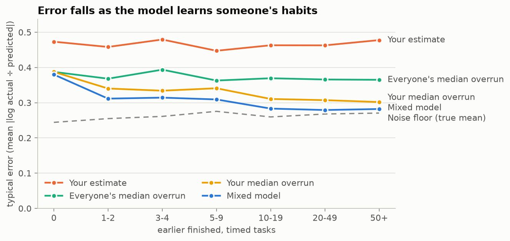
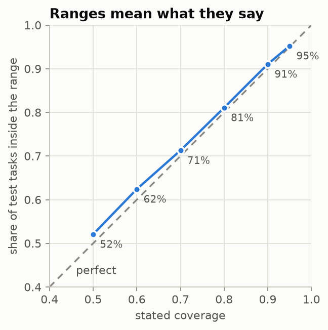

# Model card: estimate calibration

**Version 1.0.0** · trained on synthetic data · [notebook](notebooks/estimate_calibration.ipynb) · [metrics](reports/metrics.json) · served by [`calibration.ts`](../backend/src/services/estimates/calibration.ts)

## What it does

When someone types an estimate into a task, GrowthTracker can tell them how long tasks like it usually take *them*:

> Tasks like this usually take you about **1h 25m**; 8 in 10 take between 1h 10m and 1h 50m. Based on your last 10 finished timed tasks, 4 for this goal.

The model predicts `log(actual ÷ estimate)` for a planned task, then converts that back to minutes, with an 80% range.

## Model

A linear mixed model:

```
log(actual ÷ estimate) = x·β + u_person + g_goal + noise
```

| Part | Meaning |
|---|---|
| `x·β` | Population effects of log task size, priority, log(1 + subtasks) and having a due date |
| `u_person ~ N(0, τu²)` | This person's tendency to over- or underrun |
| `g_goal ~ N(0, τg²)` | An extra tendency for one of their goals; tasks without a goal share one group |
| `noise ~ N(0, σ²)` | Everything else |

β and the three variances are fitted by REML (`statsmodels` `MixedLM`) on training users. At request time the API computes the person's offsets as posterior means (BLUPs) in closed form, from their 50 most recent finished, timed tasks. With little history the offsets stay near zero; with more, the person's own record dominates.

The shipped artefact is [`model.json`](../backend/src/services/estimates/model.json) (1.2 KB): six coefficients, three variances, the range sizes and input limits. Estimates are limited to 5–480 minutes and subtasks to 20 when computing features, and the training ratio is limited to between 1/5 and 5.

## Intended use

- A suggestion in the task form, shown once someone has **3 finished tasks with both an estimate and time logged by the focus timer**. At 3 tasks their own record gets more weight than the population average: weight n / (n + σ²/τu²), with σ²/τu² = 2.6.
- The person decides. The suggestion never changes an estimate unless they press **Use**.

**Not for:** judging anyone's productivity, comparing people, or anything outside the person's own planning. It only ever uses that person's own tasks, and runs inside the API: nothing is sent to an AI provider or anywhere else.

## Data

**Training and evaluation use simulated users** ([`synth.py`](src/growthtracker_ml/synth.py)). Real data is one person's tasks, far too few. 400 users (25,108 tasks) are split **by user**: 240 to train, 80 to tune and size the ranges (validation), 80 to test.

The simulator encodes assumptions, loosely based on planning-fallacy research: on average tasks take about 25% longer than planned, people differ a lot (sd 0.25 on the log scale), and goals differ within a person (sd 0.18). Task size, priority, subtasks and due dates have small effects. Three things are deliberately **left out of the model** to keep the test honest:

- noise that varies between people;
- interrupted tasks (4%) that run 1.8–4× over;
- estimates that improve over time.

## Evaluation

Each test user's tasks are replayed in completion order. Every task is predicted from **that person's earlier tasks only**, which is what the app would have shown at the time.

| Method (80 test users, 5,285 tasks) | Mean miss | Median miss | Within 20% |
|---|---|---|---|
| Your estimate, unchanged | 36.8 min | 17.0 min | 28% |
| Everyone's median overrun | 32.1 min | 15.3 min | 35% |
| Your own median overrun so far | 28.6 min | 13.0 min | 43% |
| **This model** | **26.2 min** | **11.9 min** | **46%** |
| Noise floor: the true mean, known only in simulation | 24.7 min | 10.7 min | 50% |

The model removes 29% of the error in raw estimates, and 88% of the error that any model could remove.



**Ranges.** The 80% range is sized by split conformal prediction on validation users, separately for people with 0, 1–4, 5–19 and 20+ earlier tasks. On test users it contains **81.1%** of tasks; ranges sized for 50–95% all land within 2.5 points of their target. The median range is 56 minutes wide.



**Alternatives.** Gradient boosting with the same features plus each person's history did no better (mean absolute log error 0.290 against 0.287), with a far larger, harder-to-explain artefact. The personal offset carries most of the gain: population effects alone score 0.359; adding the personal offset brings it to 0.296, and the goal level to 0.287.

## Limitations

- **The population effects are assumptions.** Size, priority, subtask and due-date effects were learned from simulated users, so for a real person they're the simulator's assumptions until the model is retrained on real data. This is why suggestions wait for the person's own record, and why the personal offset takes over as it grows.
- **Only focus-timer time counts.** Tasks done without the timer teach it nothing, and focused time can be less than elapsed time.
- **Ranges are right on average.** One noise level is assumed for everyone, so ranges are too narrow for very inconsistent people and too wide for very consistent ones.
- **It knows little about the task**: nothing about its text, type or time of day.

## Checking and updating it

- `uv run growthtracker-ml evaluate-export <file>` scores the shipped model on a real data export (Settings → **Download my data**), locally.
- `uv run growthtracker-ml train` rebuilds the model, the parity cases and the metrics. Training is deterministic, and CI runs `growthtracker-ml check` to fail the build if the committed files don't match a fresh run.
- The API refuses to start with a `model.json` whose features don't match its code. A parity test holds the TypeScript implementation to the Python one on 29 generated cases, to 9 decimal places.
- Retraining on real data means feeding `pipeline.run` exports read with `export_data.load_export` instead of `synth.generate`, still split by user. That needs many people's exports, which don't exist yet.
