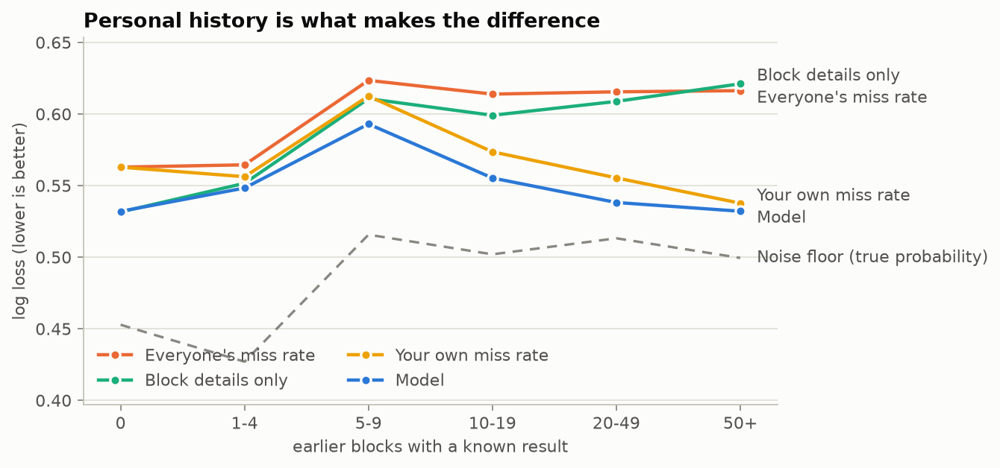
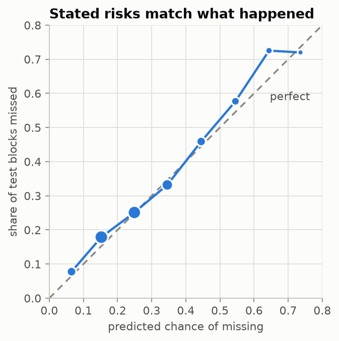

# Model card: skip risk

**Version 1.0.0** · trained on simulated data · [notebook](notebooks/skip_risk.ipynb) · [metrics](reports/skip_risk_metrics.json) · served by [`risk.ts`](../backend/src/services/skipRisk/risk.ts)

## What it does

It estimates how likely a planned time block is to be missed. The app uses it in two places:

- **Upcoming blocks** on Today and Plan show *"Likely to slip: You often miss evening blocks"* when the risk is high.
- **Plan my week** leaves suggestions the person would likely miss unticked, explains why, and tells the AI when the person usually follows through.

## Model

Logistic regression, `P(missed) = sigmoid(x · β)`, over 14 inputs:

| Input | From |
|---|---|
| Time-of-day band (early, morning, afternoon, evening, late), weekend | The block's local start time |
| log(length), log(1 + days planned ahead), other blocks that day, linked to a goal | The block |
| The person's skip rate, pulled towards the population's | Their last 100 blocks with a known result |
| Their skip rate in this time band, and for this goal, each pulled towards their own rate | The same history |
| Share of their last three blocks that were missed | The same history |

The "pulling" (shrinkage) works like a beta prior. The population rate is worth 5.7 blocks, fitted to training users by method of moments. A band's rate is pulled towards the person's own rate with the weight of 50 blocks, and a goal's with 20, both chosen on validation users. With no history, every rate equals the population's.

The shipped artefact is [`model.json`](../backend/src/services/skipRisk/model.json): 14 coefficients, the shrinkage settings, the label threshold and the input limits.

## Which blocks count, and when

- **Kept:** marked done, or worked on with the focus timer. **Missed:** marked skipped.
- **Left out:** blocks never ticked either way, and rescheduled ones. Many people never mark skips, and treating every unticked block as missed would flag almost everything they plan.
- A result counts once the block ended at least **24 hours** ago, giving people time to tick it. The evaluation uses the same rule.
- **Labels appear after 6 blocks with a known result.** That's where the person's own record outweighs the population rate (the prior's strength, rounded up).
- **A block is flagged at 50% risk or more.** That's the lowest threshold at which at least 6 in 10 flagged validation blocks were really missed.

## Intended use

A gentle prompt to plan realistically: move a block to a better time, shorten it, or accept the risk. It never changes or hides a block on its own.

**Not for:** judging anyone, comparing people, or deciding anything for them. It uses only the person's own blocks and runs inside the API; nothing is sent anywhere.

## Data

**Simulated people** ([`skiprisk/synth.py`](src/growthtracker_ml/skiprisk/synth.py)), because no real dataset exists. There are 400 people and 29,917 blocks, split **by person**: 240 to train, 80 to tune, 80 to test.

Each simulated person has their own reliability, their own good and bad times of day, and goals that slip more than others. Overall 29% of blocks are missed. Per person that ranges from 8% at the 10th percentile to 55% at the 90th.

Two things are deliberately different from the model, to keep the test honest:

- a miss makes the very next block more likely to slip, but the model only sees the share of the last three;
- each person's effects are fixed numbers, which the model can only estimate from a short record.

## Evaluation

Each test person's blocks are replayed in order. Every block is predicted only from their blocks that ended a day before it started.

| Method (80 test people, 5,567 blocks) | Log loss | AUC | Calibration error |
|---|---|---|---|
| Everyone's miss rate | 0.612 | 0.50 | 0.009 |
| Block details only | 0.606 | 0.57 | 0.018 |
| The person's own rate | 0.556 | 0.70 | 0.016 |
| **This model** | **0.543** | **0.72** | **0.018** |
| Noise floor: the true probability, known only in simulation | 0.500 | 0.78 | 0.015 |

- **Log loss and AUC:** the model removes 62% of the log loss any model could remove. AUC measures how well it ranks risky blocks above safe ones.
- **Calibration:** stated risks match what happened to within a few points across most of the range. At the top it's slightly cautious: blocks given about 64% were missed 72% of the time.
- **Flags:** at the 50% threshold, 14% of test blocks were flagged. 65% of flagged blocks were really missed, and 30% of all missed blocks were flagged in advance.
- **Gradient boosting** on the same inputs did slightly worse (log loss 0.548, AUC 0.71).

## Limitations

- **The block effects are assumptions.** Time bands, weekends, length, lead time and crowded days were learned from simulated people, so for a real person they're the simulator's guesses until the model is retrained on real records. Labels wait for the person's own history for this reason.
- **Unmarked misses are invisible.** Someone who never marks skips will look more reliable than they are, so the model errs towards saying nothing.
- **It knows only the app.** A new job, an exam term or the weather all change things, and the model only catches up as new blocks get a result.

## Checking and updating it

- `uv run growthtracker-ml train` rebuilds both models. CI runs `growthtracker-ml check`, which fails if the committed files don't match a fresh, deterministic run.
- [`skip-risk-logic.test.ts`](../backend/tests/skip-risk-logic.test.ts) holds the TypeScript to the Python on 28 generated cases, to 10 decimal places.
- The API refuses to start with a `model.json` whose features or bands don't match its code.
